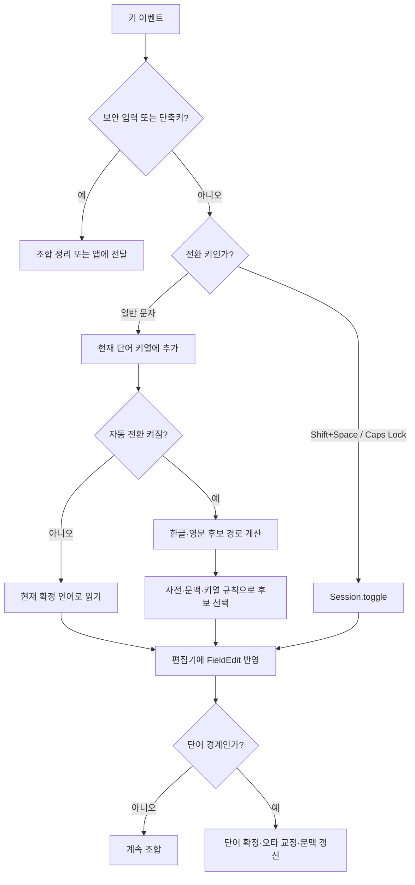
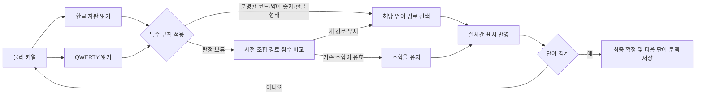
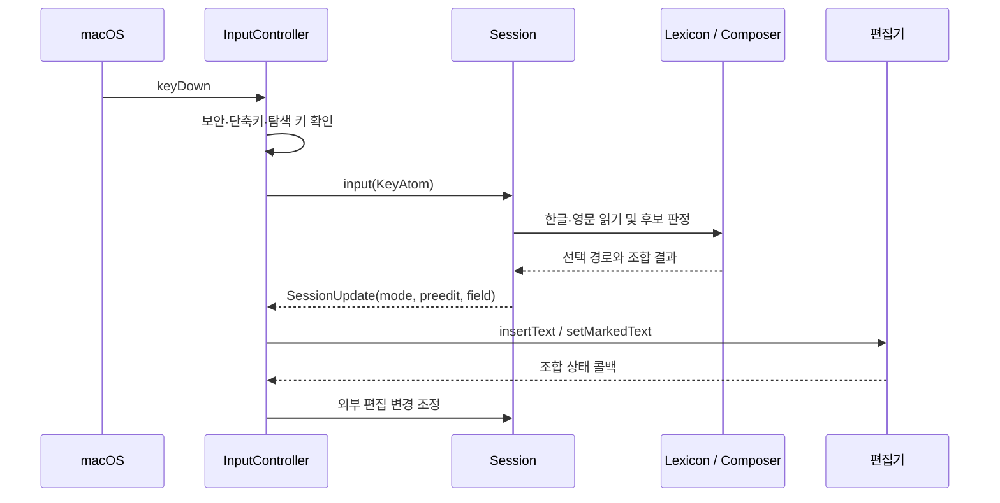

# 한/영 전환 코어

이 문서는 현재 구현의 전환 흐름을 설명합니다. 핵심 로직은 `Sources/Sebeol390Core/Session.swift`에 있고, macOS의 키 이벤트 연결은 `Sources/Sebeol390IME/InputController.swift`가 맡습니다.

## 전환 모델

세토는 글자마다 입력 언어를 바꾸지 않고, 현재 단어의 물리 키 입력 전체를 두벌식·선택한 한글 자판으로 다시 읽습니다. `Session`은 키열(`keys`), 구간별 선택 언어(`segments`), 확정 언어(`mode`), 현재 조합 표시(`preedit`)를 별도로 보관합니다.

영문은 확정되는 즉시 편집기에 삽입하고, 한글은 편집기의 표시 조합(marked text)으로 유지합니다. 판정 중 읽기가 바뀌면 `FieldEdit`를 만들어 삽입·조합 범위를 갱신합니다. 따라서 영문 접두어와 한글 어미처럼 한 단어 안에서 언어가 갈리는 경우도 처리할 수 있습니다.

## 자동 판정

1. 키를 `KeyboardLayout`의 물리 키 매핑으로 `KeyAtom`으로 바꿉니다. 각 키에는 QWERTY 읽기와 현재 한글 자판 읽기가 함께 있습니다.
2. 키열을 `Composer`와 언어별 후보 경로로 읽습니다. 후보 평가는 `Lexicon`의 한국어·영어 단어, 약어, 코드 토큰 정보와 조합 형태를 이용합니다.
3. `Session.recompute`는 강한 형태 규칙을 먼저 확인합니다. 숫자+한글 단위, 약어+조사, 코드 토큰, 연속 자모, 완성된 한글 음절, 영어 단어 및 접두어 같은 경우를 일반 점수 비교보다 우선 처리합니다.
4. 예외 규칙으로 결정되지 않으면 가능한 언어 구간 조합을 점수화합니다. 현재 화면에 보이는 조합을 불필요하게 깨지 않도록 기존 경로를 유지하며, 새 경로가 충분히 더 나을 때 읽기를 바꿉니다.
5. 읽기가 확인되면 `confirmMode`가 `mode`를 갱신합니다. 한 글쇠나 사전 접두어만으로는 확정하지 않고, 영어 단어·약어·코드 토큰 또는 충분히 분명한 한글 형태를 요구합니다.

단어 경계에서는 `finishWord`가 최종 판정을 수행하고 입력을 확정합니다. 공백과 문장 부호는 경계 입력으로 함께 처리됩니다. 문장 부호나 줄바꿈은 앞 단어 언어 문맥을 지우지만, 다음 단어의 기본 모드 자체는 유지합니다.

### 단어 안의 언어 구간

후보 경로는 단어 전체를 한 언어로만 처리하지 않습니다. `deploy했는데`, `AI로`처럼 먼저 확인된 영어·약어 뒤에 한글이 오면 구간을 나눠 선택합니다. `.`, `/`, `:`, `@` 등이 이어지는 파일명·주소·경로는 코드 토큰 규칙으로 영문 구간을 유지합니다. 한국어 조사가 붙은 파일명이나 약어는 전용 분할 규칙이 적용됩니다.

영문 모드에서는 `of`처럼 짧고 한글 음절로도 읽히는 입력을 영어 문맥에서 영문으로 유지합니다. 반대로 한글 모드에서 한글 음절이 자연스럽게 이어지는 동안에는 짧은 영어 단어처럼 보이더라도 한글 조합을 우선할 수 있습니다. 모드와 현재 단어의 후보 읽기는 서로 다를 수 있으며, 후보만 바뀐 상태에서 모드가 성급히 바뀌지 않도록 분리되어 있습니다.

## 수동 전환과 되돌리기

| 동작 | 현재 단어가 있을 때 | 조합 중이 아닐 때 |
| --- | --- | --- |
| Shift+Space 또는 Caps Lock | 현재 단어의 읽기를 반대로 고정 | 다음 입력의 기본 언어를 반대로 변경 |
| 메뉴에서 한글·영문 선택 | 현재 조합을 확정하고 선택 언어 지정 | 선택 언어 지정 |
| Control+Shift+K | 자동 전환을 켜거나 끔 | 동일 |

자동 전환 직후 수동 전환을 하면 직전 자동 판정 또는 오타 교정을 취소해 원래 친 읽기를 복원하고 해당 단어의 언어를 고정합니다. 혼합 언어 단어에서는 현재 단어 전체를 명시한 반대 읽기로 잠급니다. `locked`가 설정된 단어는 이후 자동 판정으로 덮어쓰지 않습니다. 단어가 끝나면 잠금은 해제됩니다.

자동 전환을 끄면 현재 `mode`로 입력합니다. 단, Shift+Space/Caps Lock과 메뉴의 언어 선택은 계속 쓸 수 있습니다. 메뉴 선택은 `forceMode`가 진행 중인 표시를 먼저 확정하고 다음 입력 언어를 설정합니다.

## macOS 이벤트 흐름

`SebeolInputController`는 키 이벤트를 받아 `Session`을 호출하고, 반환된 `FieldEdit`를 `IMKTextInput`의 삽입·표시 조합 API로 적용합니다. 화살표·Tab·Return·Esc 등 탐색 키는 현재 입력을 확정한 뒤 앱으로 전달합니다. Command·Control·Option 조합도 조합을 정리하고 앱에 넘기며, Control+,와 Control+.는 별도 화살표 입력으로 처리합니다.

입력 컨텍스트가 새로 시작되면 세션과 단어 문맥을 초기화합니다. 기본은 한글이며 Terminal과 감지된 브라우저 주소창은 영문으로 시작하고 자동 전환을 끕니다. Safari·Chrome 주소창 감지는 접근성 권한이 필요하며, 주소창 여부를 처음 키 입력 때 한 번 더 확인할 수 있습니다. 보안 입력에서는 진행 중 조합을 버리고 키 처리를 앱에 넘깁니다.

## 주요 상태와 구현 위치

| 개념 | 역할 | 구현 |
| --- | --- | --- |
| `mode` | 확인된 현재 언어, 다음 단어의 기본값 | `Session` |
| `wordMode` | 현재 단어가 시작될 때의 언어 | `Session` |
| `segments` | 현재 단어를 나눈 언어 구간 | `Session` |
| `locked` | 사용자가 명시적으로 고정한 현재 단어 언어 | `Session` |
| `preedit` | 편집기가 표시하는 미확정 한글 조합 | `Session` |
| `FieldEdit` | 편집기에 전달할 삽입·교체·조합 명령 | `Session` |
| 자동 후보 비교 | 후보 읽기, 경계, 문맥, 특수 토큰 처리 | `Session.recompute` |
| 물리 키 처리 | macOS 키 코드에서 QWERTY 문자 추출 | `Keymap`, `InputController` |
| 키별 한글 읽기 | 선택 자판의 한글·영문 `KeyAtom` 생성 | `KeyboardLayout`, `Layout390`, `LayoutDubeol`, `LayoutFinal` |
| 사전 판정 | 단어·약어·코드 토큰 판별 | `Lexicon` |

전환 예시와 사용자 설정은 저장소 루트의 `README.md`에, 기본 조합·전환 동작 검증은 `Tests/Sebeol390CoreTests/SessionTests.swift`에 정리되어 있습니다.
