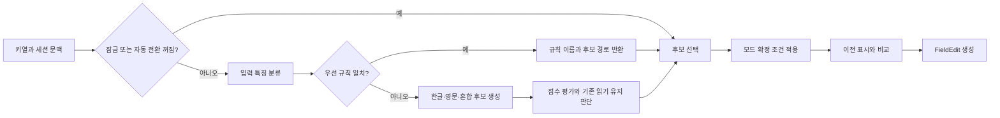
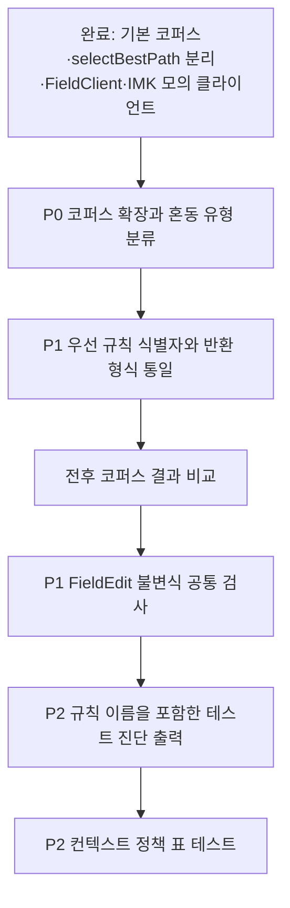

# 한/영 전환 개선 제안

이 문서는 [코어 전환 설명](core.md)과 현재 구현을 바탕으로, 전환 품질을 높이고 이후 변경을 안전하게 만드는 작업을 제안합니다. 아래 항목은 현재 결함으로 단정하는 목록이 아니라, 코드의 복잡도와 전환의 특성에서 도출한 개선 방향입니다. 각 항목에는 이미 반영된 부분(현재 상태)과 남은 작업을 구분해 적습니다.

## 목표

- 입력 중 언어가 바뀌는 시점과 이유를 개발자가 추적할 수 있게 합니다.
- 한글·영문·숫자·코드가 섞인 실제 입력에서 회귀를 빠르게 찾습니다.
- 규칙 우선순위와 편집기 동기화 변경을 서로 독립적으로 검증합니다.
- 사용자 데이터나 네트워크 없이도 전환 품질을 측정할 수 있게 합니다.

## 우선순위 제안

| 우선순위 | 제안 | 현재 상태 | 기대 효과 | 범위 |
| --- | --- | --- | --- | --- |
| P0 | 전환 평가 코퍼스 확장과 혼동 유형 분류 | 8개 사례의 기본 코퍼스 있음 | 규칙 수정의 품질을 비교하고 회귀를 조기에 발견 | 테스트·개발 도구 |
| P1 | `Session.recompute` 우선 규칙에 식별자 부여 | 점수 선택 단계(`selectBestPath`)와 읽기 반영(`installReading`)만 분리됨 | 규칙 의존성과 우선순위를 읽고 수정하기 쉬움 | 코어 리팩터링 |
| P1 | 편집 명령 시뮬레이션의 불변식 일반화 | `FieldClient` 가상 편집기와 IMK 모의 클라이언트 있음 | marked text, 이미 삽입된 영문, 교체 범위 오류 감소 | 코어 테스트·IMK 통합 |
| P2 | 전환 근거를 담는 제한적 진단 출력 | `debugLine`이 구간·모드·잠금·조합만 표시 | 모호한 자동 전환을 재현하고 분석하기 쉬움 | 개발 전용 진단 |
| P2 | 입력 컨텍스트 정책 검증 보강 | 주소창 판별과 Terminal·주소창 시작 정책 테스트 있음 | 앱별 시작 언어·자동 전환 정책의 예측 가능성 향상 | macOS 통합 |

## 1. 전환 평가 코퍼스

**현재 상태**: `Tests/Sebeol390CoreTests/TransitionCorpusTests.swift`에 이름, 키열, 시작 모드, 기대 문자열, 기대 모드를 담은 사례 8개가 있습니다. 영어 단어, 한국어 단어, 영어 어간 + 한글 어미, 약어 + 조사, 파일명, 영어 문맥의 짧은 단어를 다룹니다. 각 사례는 마지막 키 뒤와 공백으로 단어를 확정한 뒤의 문자열과 `mode`를 확인합니다. 회귀 사례 대부분은 여전히 `SessionTests.swift`에 개별 테스트로 흩어져 있습니다.

**남은 작업**: 코퍼스를 다음 유형으로 넓힙니다.

- 한글 문장과 자연스러운 영문 단어, 짧은 동음형 입력
- 숫자와 단위, 날짜·소수·천 단위 표기 (세벌식 390 Shift 숫자 포함)
- 약어·파일명·URL·경로·버전 표기와 그 뒤의 조사
- 연속 자모, 한 글쇠 입력, 불완전한 접두어
- 문장부호, 공백, 줄바꿈 전후의 문맥 변화
- 수동 전환(Shift+Space)과 자동 전환 취소, 오타 교정 결과
- 두벌식·세벌식 390·세벌식 최종별 동일 QWERTY 물리 키열 (현재 코퍼스는 기본값인 세벌식 390만 사용)

최종 출력과 단어 끝 모드만 비교하면 단어 중간에 잘못 전환했다가 경계에서 우연히 복구되는 문제를 놓칠 수 있습니다. 사례마다 키별 `preedit`, 확정 `mode`, `didAutoConvert`를 선택적으로 기대값에 넣을 수 있게 합니다. 오답은 `영문으로 남아야 하는데 한글로 바뀜`, `전환이 늦음`, `혼합 구간 분할 오류`처럼 원인 유형으로 분류합니다. `SessionTests.swift`의 대표 회귀 사례 중 키열과 기대 결과만으로 표현되는 것은 코퍼스로 옮겨 한곳에서 통과율을 볼 수 있게 합니다.

입력 내용은 공개 사전 예문이나 사람이 작성한 합성 사례로 구성합니다. 기기에 남는 재입력 기록(`TypoLog`)이나 타자 통계(`TypingStatistics`)를 코퍼스 자료로 쓰지 않습니다. 성능 측정은 코퍼스 단위 실행 시간과 키 한 번당 최악·상위 백분위 시간을 기록하는 정도로 시작합니다.

## 2. 판정 규칙 단계 분리

**현재 상태**: `Session.recompute`는 잠금·자동 전환 꺼짐 처리 뒤 십여 개의 우선 규칙(`singleKRoSplit`, `codeParticleSplit`, `prefersNumberWithKoreanTail`, `prefersCapitalizedEnglish`, `acronymParticleSplit`, `prefersContextualEnglish`, `prefersCurrentEnglishMode`, `prefersWholeKorean`, `prefersWholeEnglishCode`, `prefersWholeEnglishWord` 등)을 순서대로 확인합니다. 규칙이 정해지지 않으면 `selectBestPath`가 점수 경로를 고르고 기존 읽기 유지를 판단합니다. 규칙이 고른 읽기는 `installReading`으로 반영됩니다. 모드 확정은 `confirmMode`로 분리되어 있습니다. 다만 우선 규칙의 순서는 여전히 메서드 안의 `if` 순서로만 표현되고, 일부 규칙(`prefersContextualEnglish`)은 되돌리기 읽기를 따로 설정하는 등 반환 형식이 다릅니다.

**남은 작업**: 결과를 명시하는 내부 단계로 마저 나눕니다.

1. **입력 분류**: 숫자열, 코드 토큰, 약어, 조사·어미, 연속 자모, 두벌식 자리 키 여부 등 특징을 한 번 계산합니다.
2. **우선 규칙**: 각 규칙이 이름과 후보 읽기(필요하면 되돌리기 읽기 포함)를 반환하도록 형식을 통일합니다.
3. **후보 생성·평가**: 현재 `bestPath`·`score`가 하는 한글·영문·혼합 구간 경로 생성과 평가를 유지합니다.
4. **기존 읽기 유지**: `selectBestPath`의 조합 보존·`Scoring.margin` 판단을 유지합니다.
5. **전환 확정**: 선택 경로와 별도로 `confirmMode`의 확정 요건을 적용합니다.
6. **편집 명령 생성**: 선택 결과와 이전 화면 차이를 `FieldEdit`로 변환합니다.

각 규칙은 이름, 적용 조건, 우선순위, 관련 코퍼스 사례를 함께 갖도록 합니다. 처음부터 범용 규칙 프레임워크로 옮기기보다, 현재 우선순위를 유지한 채 규칙 목록과 반환 형식을 먼저 정리하는 편이 안전합니다. 구조 변경 전후에 동일 코퍼스 결과가 유지되는지 확인합니다.

## 3. 편집 명령과 편집기 검증

`FieldEdit`는 단순 삽입부터 커서 앞 UTF-16 범위 교체, 기존 조합 삭제 후 삽입, 단어 재작성까지 표현합니다. 이 명령의 정확성은 코어가 계산한 텍스트뿐 아니라 편집기가 실제로 보유한 committed text와 marked range에 달려 있습니다.

**현재 상태**:

- `SessionTests.swift`의 `FieldClient`가 TextEdit처럼 동작하는 가상 편집기로 `FieldEdit`를 적용하고, 일부 테스트에서 화면 텍스트가 `Session.document`와 같은지 확인합니다.
- `test-imk-client.sh`가 `Tests/Integration/ClientSmoke.swift`를 빌드해 실제 `SebeolInputController`를 모의 IMK 클라이언트로 실행합니다. 재진입하는 확정 콜백, Chrome의 늦게 갱신되는 선택 영역, Discord 자리표시 문자, Terminal의 Return 처리, 단축키 통과, 자판별 Shift 입력 같은 사례가 있습니다. 이 검증은 macOS GUI 로그인 세션이 필요해 `swift test`에 포함되지 않습니다.

**남은 작업**: 불변식 확인을 개별 테스트가 아닌 공통 검사로 만들어, 코퍼스와 기존 테스트의 모든 키 입력 뒤에 적용합니다.

- 화면의 committed text와 marked text를 합친 값이 `Session.document`와 일치합니다.
- marked range가 없는 편집 명령은 보이지 않는 조합을 남기지 않습니다.
- 이미 삽입한 영문 접두어는 재전환 시 중복 삽입되거나 유실되지 않습니다.
- UTF-16 길이를 사용하는 교체 범위가 한글, 결합 문자, 이모지 주변에서 경계를 넘지 않습니다.
- 삭제, 토글, 확정 뒤 되돌리기, 외부 커서 이동 뒤 다음 입력이 이전 텍스트를 다시 삽입하지 않습니다.

IMK 모의 클라이언트 사례는 편집기 동작 계약별로 이름을 붙여 실패 원인을 좁힐 수 있게 합니다. 실제 앱별 문제를 추가할 때는 앱 버전과 최소 재현 키열을 기록합니다. iOS 하드웨어 키보드 편집기는 표시 조합 대신 `KeyboardReplacement`로 글자 단위 교체를 하므로, 같은 코퍼스를 그 경로로도 재생해 결과가 같은지 확인하는 것을 고려합니다.

## 4. 전환 진단 정보

**현재 상태**: `Session.debugLine`이 문서, 언어 구간, `mode`, 잠금, 조합 문자열을 한 줄로 보여 주며 테스트 실패 메시지에 쓰입니다. 어떤 우선 규칙이 적용됐는지, 후보 점수가 얼마였는지는 드러나지 않습니다.

**남은 작업**: 개발 중에만 사용할 수 있는 구조화된 진단 이벤트를 제안합니다. 이벤트에는 입력 키열, 이전·선택 언어 구간, 적용한 규칙 식별자(2절), 후보 점수, 전환 여부, 편집 명령 종류를 포함할 수 있습니다. 키 입력 전체를 저장하는 상시 로그가 아니라, 테스트에서 반환하거나 사용자가 명시적으로 켠 임시 진단으로 제한합니다.

진단을 추가한다면 다음 원칙을 적용합니다.

- 기본 설정은 비활성화하고 암호·보안 입력에서는 생성하지 않습니다.
- 텍스트 원문과 키열을 기본 로그에 기록하지 않습니다. 재현 테스트용 자료는 별도로 직접 작성합니다. 오타 교정용 `TypoLog`(Application Support의 `typos.jsonl`)는 교정 기능을 위한 기기 내 기록이며 진단 용도로 확장하지 않습니다.
- 규칙 식별자와 판정 사유는 표시하되 사전 내부 데이터나 개인 학습 데이터를 노출하지 않습니다.
- 자동 전환 비활성화, 수동 고정, 자동 전환 취소, 오타 교정, 사전 불일치 상태를 구분합니다.

진단의 첫 구현은 `debugLine`에 적용 규칙 이름을 덧붙여 테스트 실패 메시지에 판정 경로를 출력하는 형태가 적절합니다. 이 방식은 사용자가 입력한 내용을 보관하지 않으면서 규칙 충돌을 설명하는 데 도움이 됩니다.

## 5. 입력 컨텍스트 정책

macOS 컨트롤러는 일반 입력, Terminal, Safari·Chrome 주소창에 서로 다른 초기 언어, 자동 전환, 오타 교정 정책을 적용합니다. Terminal 정책은 설정(기본 켜짐, Control+Shift+T)으로 끌 수 있습니다. 주소창 탐지는 접근성 상태와 포커스 이동 시점에 영향을 받으므로, 활성화 때 주소창이 아니었던 브라우저 컨텍스트는 첫 키 입력 때 한 번 더 확인합니다.

**현재 상태**: `AddressBarTests.swift`가 Safari 식별자, Chrome 주소창, 웹 페이지 입력란, 다른 앱과 보안 입력란을 판별 단위로 검증합니다. IMK 모의 클라이언트는 Terminal과 다른 앱을 오가며 시작 언어가 바뀌는지, 주소창과 일반 브라우저 입력을 오가며 시작 언어가 바뀌고 저장된 설정이 그대로인지 확인합니다.

**남은 작업**:

- 컨텍스트별 초기 `mode`, 자동 전환, 오타 교정 정책을 하나의 표 형태 테스트로 묶습니다. 현재 Terminal 사례는 `terminalUsesEnglishDefaults` 기본값에 의존하므로, 설정을 켠 경우와 끈 경우를 명시적으로 고정합니다.
- 주소창 판별 불가(접근성 권한 없음)와 주소창이 아닌 경우를 구분해 기본 정책이 일관적인지 검증합니다.
- `Control+Shift+K`로 바꾼 컨텍스트 임시 설정이 저장된 설정을 바꾸지 않고 컨텍스트 재진입 시 초기화되는지 테스트합니다. `Control+Shift+T`가 현재 Terminal 컨텍스트를 즉시 다시 시작하는지도 확인합니다.
- 첫 키 입력 때의 주소창 재확인이 단축키 입력에서는 일어나지 않는지 확인합니다.
- Safari·Chrome 외 브라우저 지원을 추가할 때 앱 식별자, 접근성 역할, 포커스 지연 처리를 각각 검증합니다.

## 단계별 진행

### 완료 기준

- 모든 코퍼스 사례가 세 자판에서 기대하는 최종 문자열과 모드를 검증하고, 필요한 사례는 키별 조합 결과도 검증합니다.
- 판정 규칙 변경 시 기존 사례의 결과 차이를 확인할 수 있습니다.
- `FieldEdit` 시뮬레이션이 모든 코퍼스 키 입력 뒤 문서·조합 상태 불일치를 자동으로 검출합니다.
- 진단 출력만으로 전환을 선택한 규칙과 입력 컨텍스트를 알 수 있으며, 기본 사용 중에는 입력 내용을 저장하지 않습니다.
- `Session` 내부 경계 분리 후 사용자 관찰 동작과 기존 테스트 결과가 유지됩니다. 의도된 동작 변경은 코퍼스 기대값과 [core.md](core.md)에 함께 반영합니다.

## 진행 순서 제안

기본 코퍼스와 점수 선택 단계 분리는 이미 반영됐으므로, 먼저 코퍼스를 넓히고 혼동 유형을 정해 현재 동작의 기준선을 단단히 합니다. 그 다음 규칙 코드를 옮기기보다 우선 규칙에 이름을 붙이고 반환 형식을 통일해 각 규칙에 코퍼스 사례를 연결합니다. 기준선이 안정되면 `FieldClient` 불변식을 공통 검사로 만들고 IMK 콜백 사례를 확장합니다. 진단 도구와 컨텍스트 정책 확장은 이 자료에서 반복적으로 드러나는 문제를 기준으로 진행합니다.
