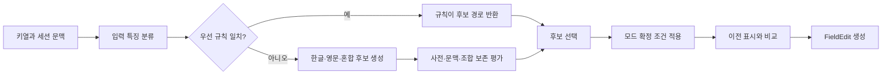
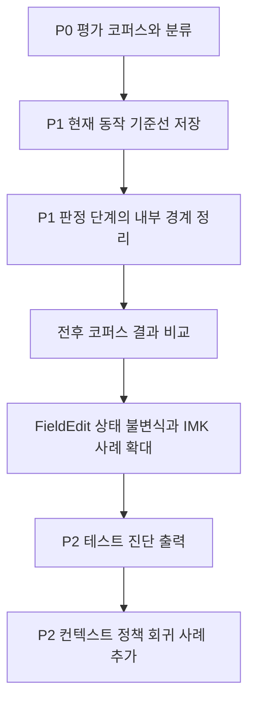

# 한/영 전환 개선 제안

이 문서는 [코어 전환 설명](core.md)과 현재 구현을 바탕으로, 전환 품질을 높이고 이후 변경을 안전하게 만드는 작업을 제안합니다. 아래 항목은 현재 결함으로 단정하는 목록이 아니라, 코드의 복잡도와 전환의 특성에서 도출한 개선 방향입니다.

## 목표

- 입력 중 언어가 바뀌는 시점과 이유를 개발자가 추적할 수 있게 합니다.
- 한글·영문·숫자·코드가 섞인 실제 입력에서 회귀를 빠르게 찾습니다.
- 규칙 우선순위와 편집기 동기화 변경을 서로 독립적으로 검증합니다.
- 사용자 데이터나 네트워크 없이도 전환 품질을 측정할 수 있게 합니다.

## 우선순위 제안

| 우선순위 | 제안 | 기대 효과 | 범위 |
| --- | --- | --- | --- |
| P0 | 전환 평가 코퍼스와 혼동 사례 기록 | 규칙 수정의 품질을 비교하고 회귀를 조기에 발견 | 테스트·개발 도구 |
| P1 | `Session.recompute`의 판정 단계를 분리 | 규칙 의존성과 우선순위를 읽고 수정하기 쉬움 | 코어 리팩터링 |
| P1 | 편집기 편집 명령의 시뮬레이션 검증 확대 | marked text, 이미 삽입된 영문, 교체 범위 오류 감소 | 코어 테스트·IMK 통합 |
| P2 | 전환 근거를 담는 제한적 진단 출력 | 모호한 자동 전환을 재현하고 분석하기 쉬움 | 개발 전용 진단 |
| P2 | 입력 컨텍스트 감지의 독립 검증 | 앱별 시작 언어·자동 전환 정책의 예측 가능성 향상 | macOS 통합 |

## 1. 전환 평가 코퍼스

현재 `SessionTests.swift`에는 개별 회귀 사례와 많은 입력 예시가 있지만, 하나의 입력 모음으로 전체 품질을 평가하는 형식은 분명하지 않습니다. 대표 입력을 데이터로 모으고 기대 결과, 자동 전환 여부, 전환이 확정돼야 하는 키 위치를 함께 기록하는 방식을 제안합니다.

코퍼스는 적어도 다음 유형을 포함합니다.

- 한글 문장과 자연스러운 영문 단어, 짧은 동음형 입력
- 영문에서 한글 어미·조사로 이어지는 혼합 단어
- 숫자와 단위, 날짜·소수·천 단위 표기
- 약어·파일명·URL·경로·버전 표기
- 연속 자모, 한 글쇠 입력, 불완전한 접두어
- 문장부호, 공백, 줄바꿈 전후의 문맥 변화
- 두벌식·세벌식 390·세벌식 최종별 동일 QWERTY 물리 키열

각 사례는 최종 문자열뿐 아니라 키마다의 `preedit`, 확정 `mode`, `didAutoConvert`도 확인할 수 있게 합니다. 최종 출력만 비교하면 단어 중간에 잘못 전환했다가 경계에서 우연히 복구되는 문제를 놓칠 수 있습니다. 오답은 `영문으로 남아야 하는데 한글로 바뀜`, `전환이 늦음`, `혼합 구간 분할 오류`처럼 원인 유형으로 분류합니다.

입력 내용은 공개 사전 예문이나 사람이 작성한 합성 사례로 구성하고 개인 타자 기록을 수집하지 않습니다. 성능 측정은 코퍼스 단위 실행 시간과 키 한 번당 최악·상위 백분위 시간을 기록하는 정도로 시작합니다.

## 2. 판정 규칙 단계 분리

현재 `Session.recompute`는 특수 패턴 조기 반환, 문맥 예외, 언어 경로 선택, 기존 조합 유지 판단을 순서대로 처리합니다. 여러 특수 규칙이 한 메서드에 있어 규칙을 추가할수록 순서가 암묵적인 동작 계약이 됩니다.

다음과 같이 결과를 명시하는 내부 단계로 나누는 방안을 제안합니다.

1. **입력 분류**: 숫자열, 코드 토큰, 약어, 조사·어미, 연속 자모 등 특징을 계산합니다.
2. **강제 규칙**: 안전하게 우선할 수 있는 특수 분할이나 명확한 읽기를 반환합니다.
3. **후보 생성**: 한글·영문 및 혼합 구간 경로를 생성합니다.
4. **후보 평가**: 사전 적합도, 현재 모드, 직전 문맥, 조합 보존 비용을 평가합니다.
5. **전환 확정**: 선택 경로와 별도로 `mode` 확정 요건을 적용합니다.
6. **편집 명령 생성**: 선택 결과와 이전 화면 차이를 `FieldEdit`로 변환합니다.

각 규칙은 이름, 적용 조건, 우선순위, 관련 예시 테스트를 함께 갖도록 합니다. 처음부터 모든 조건을 범용 규칙 프레임워크로 옮기기보다, 현재 우선순위를 유지한 채 데이터 전달 경계를 먼저 정리하는 편이 안전합니다. 구조 변경 전후에 동일 코퍼스 결과가 유지되는지 확인합니다.

## 3. 편집 명령과 편집기 검증

`FieldEdit`는 단순 삽입부터 커서 앞 UTF-16 범위 교체, 기존 조합 삭제 후 삽입, 단어 재작성까지 표현합니다. 이 명령의 정확성은 코어가 계산한 텍스트뿐 아니라 편집기가 실제로 보유한 committed text와 marked range에 달려 있습니다.

테스트용 가상 편집기에서 각 `FieldEdit`를 적용한 뒤 다음 상태 불변식을 확인하는 것을 제안합니다.

- 화면의 committed text와 marked text를 합친 값이 `Session.document`와 일치합니다.
- marked range가 없는 편집 명령은 보이지 않는 조합을 남기지 않습니다.
- 이미 삽입한 영문 접두어는 재전환 시 중복 삽입되거나 유실되지 않습니다.
- UTF-16 길이를 사용하는 교체 범위가 한글, 결합 문자, 이모지 주변에서 경계를 넘지 않습니다.
- 삭제, 토글, 단어 확정, 외부 커서 이동 뒤 다음 입력이 이전 텍스트를 다시 삽입하지 않습니다.

코어 시뮬레이션과 별도로 macOS IMK 모의 클라이언트 검증을 편집기 동작 계약별로 구성합니다. 재진입하는 확정 콜백, 표시 조합 해제, 선택 영역 변경, 동기 삽입 중 콜백을 각각 테스트 이름으로 드러내면 실패 원인을 좁힐 수 있습니다. 실제 앱별 문제를 추가할 때는 앱 버전과 최소 재현 키열을 기록합니다.

## 4. 전환 진단 정보

개발 중에만 사용할 수 있는 구조화된 진단 이벤트를 제안합니다. 이벤트에는 입력 키열, 이전·선택 언어 구간, 적용한 규칙 식별자, 후보 점수, 전환 여부, 편집 명령 종류를 포함할 수 있습니다. 키 입력 전체를 저장하는 상시 로그가 아니라, 테스트에서 반환하거나 사용자가 명시적으로 켠 임시 진단으로 제한합니다.

진단을 추가한다면 다음 원칙을 적용합니다.

- 기본 설정은 비활성화하고 암호·보안 입력에서는 생성하지 않습니다.
- 텍스트 원문과 키열을 기본 로그에 기록하지 않습니다. 재현 테스트용 자료는 별도로 직접 작성합니다.
- 규칙 식별자와 판정 사유는 표시하되 사전 내부 데이터나 개인 학습 데이터를 노출하지 않습니다.
- 자동 전환 비활성화, 수동 고정, 사전 불일치 상태를 구분합니다.

진단의 첫 구현은 영속 로그보다 테스트 실패 메시지에 판정 경로를 출력하는 형태가 적절합니다. 이 방식은 사용자가 입력한 내용을 보관하지 않으면서 규칙 충돌을 설명하는 데 도움이 됩니다.

## 5. 입력 컨텍스트 정책

macOS 컨트롤러는 일반 입력, Terminal, 브라우저 주소창에 서로 다른 초기 언어와 자동 전환 정책을 적용합니다. 주소창 탐지는 접근성 상태와 포커스 이동 시점에 영향을 받으므로, 정책 결정과 UI 요소 감지를 별도로 확인할 필요가 있습니다.

- 컨텍스트별 초기 `mode`, 자동 전환, 오타 교정 정책을 표 형태의 테스트로 고정합니다.
- 주소창 판별 불가와 주소창이 아닌 경우를 구분해 기본 정책이 일관적인지 검증합니다.
- 사용자가 `Control+Shift+K`로 변경한 컨텍스트 임시 설정이 컨텍스트 재진입 시 초기화되는 조건을 테스트합니다.
- Safari·Chrome 외 브라우저 지원을 추가할 때 앱 식별자, 접근성 역할, 포커스 지연 처리를 각각 검증합니다.

## 단계별 진행

### 완료 기준

- 모든 코퍼스 사례가 기대하는 키별 조합 결과와 최종 문자열을 검증합니다.
- 판정 규칙 변경 시 기존 사례의 결과 차이를 확인할 수 있습니다.
- `FieldEdit` 시뮬레이션에서 문서·조합 상태 불일치를 자동으로 검출합니다.
- 진단 출력만으로 전환을 선택한 규칙과 입력 컨텍스트를 알 수 있으며, 기본 사용 중에는 입력 내용을 저장하지 않습니다.
- `Session` 내부 경계 분리 후 사용자 관찰 동작과 기존 테스트 결과가 유지됩니다. 의도된 동작 변경은 코퍼스 기대값 및 문서에 함께 반영합니다.

## 진행 순서 제안

먼저 코퍼스와 혼동 유형을 정해 현재 동작의 기준선을 만듭니다. 그 다음 규칙 코드를 옮기기보다 판정 단계의 입력·출력 경계를 명확히 하고, 각 단계에 기존 사례를 연결합니다. 기준선이 안정되면 편집 명령 상태 검증과 IMK 콜백 사례를 확장합니다. 진단 도구와 컨텍스트 정책 확장은 이 자료에서 반복적으로 드러나는 문제를 기준으로 진행합니다.
